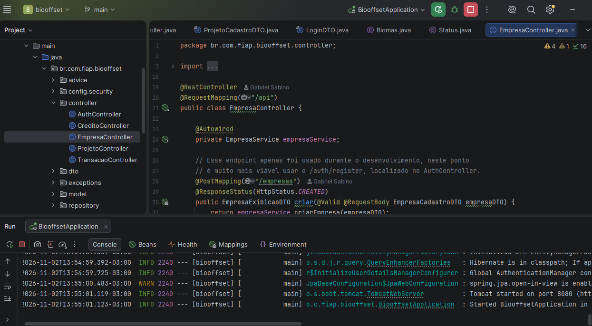
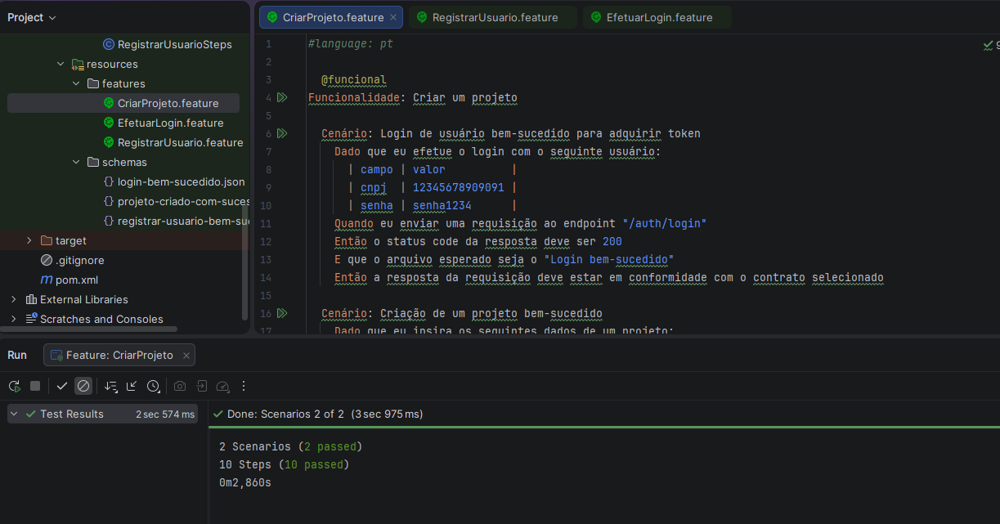
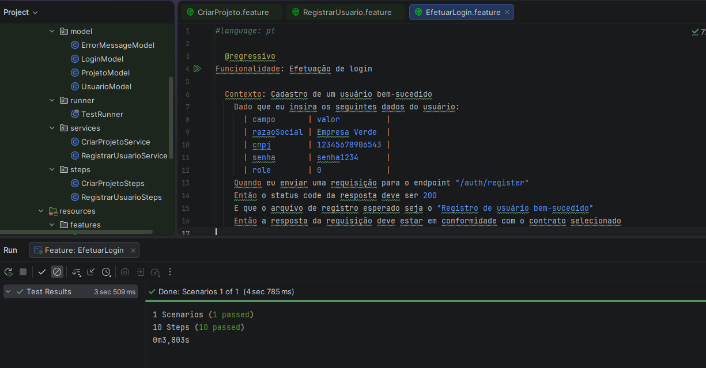
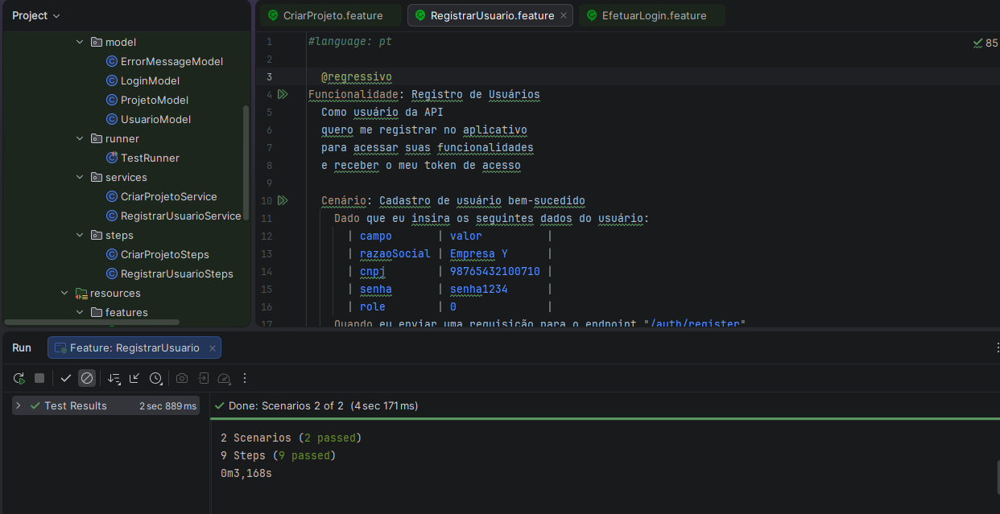

# BioOffset 🍃 - Automação de Testes de API

Este repositório contém a suíte de **testes automatizados de API** desenvolvida para o projeto **BioOffset**, realizada durante atividades acadêmicas no centro universitário **FIAP**.

---

## 📌 Sobre a Plataforma

O **BioOffset** é uma plataforma que conecta desenvolvedores de projetos ambientais (proprietários de terras que preservam florestas nativas ou realizam reflorestamento) a empresas que precisam compensar suas emissões inevitáveis de gases de efeito estufa.

A API permite que as empresas comprem créditos de carbono e publiquem seus próprios projetos na plataforma, disponibilizando créditos para aquisição com integridade e transparência.

---

## 🛠️ Tecnologias Utilizadas

### 🧪 Automação de Testes & Qualidade de Software
- **Java 21**: Linguagem de programação moderna utilizada como base para a automação.
- **Cucumber (Java & JUnit 4)**: Framework de automação orientado a comportamento (**BDD - Behavior-Driven Development**), permitindo a escrita de especificações vivas em linguagem natural (**Gherkin**).
- **JUnit 4**: Runner e framework de asserções para orquestração da execução dos testes.
- **REST Assured**: Biblioteca Java desenvolvida para teste e validação de APIs REST via DSL fluente (Given/When/Then).
- **NetworkNT JSON Schema Validator (`com.networknt:json-schema-validator`)**: Validação de conformidade de contrato de payloads JSON contra schemas estruturados (especificação JSON Schema Draft-07).
- **Google Gson & org.json**: Serialização, desserialização de modelos Java para payloads JSON e inspeção dinâmica de nós JSON.
- **Project Lombok**: Redução de boilerplate de código Java (`@Data`, getters, setters e construtores) nos modelos de transferência de dados (DTOs/POJOs).
- **Maven & Maven Surefire Plugin**: Gerenciamento de dependências, ciclo de vida do build e execução automatizada da suíte de testes.

### 🚀 Infraestrutura & CI/CD
- **Docker**: Containerização da aplicação para padronização e reprodução ágil do ambiente de desenvolvimento e testes.
- **Docker Hub**: Container Registry para armazenamento e versionamento das imagens Docker geradas.
- **Azure Web App for Containers**: Serviço em nuvem gerenciado para hospedagem e publicação contínua dos containers da aplicação.
- **GitHub Actions**: Orquestrador de pipelines de Integração Contínua (CI) e Entrega Contínua (CD).
- **GitHub Secrets**: Gerenciamento seguro de credenciais, variáveis de ambiente de banco de dados, chaves JWT e tokens da Azure/Docker Hub.

---

## 🏗️ Arquitetura da Suíte de Testes

A suíte adota o padrão **Service / Steps / Model** para separação de responsabilidades:

```
src/test/
├── java/
│   ├── hook/
│   │   └── Hook.java                     # Teardown pós-cenários (limpeza de dados de teste)
│   ├── model/
│   │   ├── ErrorMessageModel.java        # Modelo para respostas de erro
│   │   ├── LoginModel.java               # Payload de autenticação
│   │   ├── ProjetoModel.java             # Payload de cadastro de projeto
│   │   └── UsuarioModel.java             # Payload de registro de empresa/usuário
│   ├── runner/
│   │   └── TestRunner.java               # Runner do Cucumber com tags e relatórios
│   ├── services/
│   │   ├── CriarProjetoService.java      # Requisições REST de Login e Criação de Projetos
│   │   └── RegistrarUsuarioService.java  # Requisições REST de Registro, Contrato e Teardown
│   └── steps/
│       ├── CriarProjetoSteps.java        # Step definitions para login e projetos
│       └── RegistrarUsuarioSteps.java    # Step definitions para registro e contratos
└── resources/
    ├── features/
    │   ├── CriarProjeto.feature          # Cenários de criação de projetos ambientais
    │   ├── EfetuarLogin.feature          # Cenários de autenticação de usuários
    │   └── RegistrarUsuario.feature      # Cenários de registro de usuários/empresas
    └── schemas/
        ├── login-bem-sucedido.json       # JSON Schema do token JWT
        ├── projeto-criado-com-sucesso.json # JSON Schema do projeto criado
        └── registrar-usuario-bem-sucedido.json # JSON Schema da empresa cadastrada
```

---

## 📋 Cenários de Teste em Gherkin

Os testes foram elaborados seguindo a metodologia **BDD**, utilizando a sintaxe **Gherkin** em português (`#language: pt`) e organizados por tags estratégicas (`@regressivo` e `@funcional`).

### 1. `RegistrarUsuario.feature` (Tag: `@regressivo`)
Valida o fluxo de onboarding e cadastro de novas empresas desenvolvedoras/compradoras na plataforma.

* **Cenário: Cadastro de usuário bem-sucedido (Caminho Feliz)**
  * **Dado**: Que sejam inseridos os dados cadastrais válidos (`razaoSocial`, `cnpj`, `senha` e `role`).
  * **Quando**: Uma requisição `POST` for disparada contra o endpoint `/auth/register`.
  * **Então**: O status code retornado deve ser `200 OK`.
  * **E**: A resposta deve validar o schema `registrar-usuario-bem-sucedido.json`, garantindo que os campos `id`, `razaoSocial` e `role` estejam presentes e tipados corretamente.

* **Cenário: Cadastro de um usuário sem sucesso ao inserir um CNPJ incorreto (Caminho de Exceção)**
  * **Dado**: Que sejam inseridos dados contendo um `cnpj` inválido/incompleto (ex.: `987654321`).
  * **Quando**: Uma requisição `POST` for disparada contra `/auth/register`.
  * **Então**: O status code retornado deve ser `400 Bad Request`.
  * **E**: A mensagem de validação contida no corpo da resposta deve corresponder a `"Por favor, informe um CNPJ válido."`.

---

### 2. `EfetuarLogin.feature` (Tag: `@regressivo`)
Valida a geração de credenciais de acesso seguro (Token JWT) para empresas previamente registradas.

* **Contexto (Pré-condição)**:
  * Garante que uma empresa seja registrada previamente através do endpoint `/auth/register` e que o contrato da resposta esteja em conformidade.
* **Cenário: Login de usuário bem-sucedido**
  * **Dado**: Que sejam fornecidas as credenciais cadastradas (`cnpj` e `senha`).
  * **Quando**: Uma requisição `POST` for submetida ao endpoint `/auth/login`.
  * **Então**: O status code deve ser `200 OK`.
  * **E**: O payload retornado deve estar em conformidade com o schema `login-bem-sucedido.json`, atestando a presença obrigatória da propriedade `token`.

---

### 3. `CriarProjeto.feature` (Tag: `@funcional`)
Valida a publicação de projetos ambientais na plataforma, requerendo autenticação Bearer Token e validação geográfica.

* **Cenário 1: Login de usuário bem-sucedido para adquirir token**
  * **Dado**: Que seja efetuado o login com credenciais válidas.
  * **Quando**: Enviada a requisição ao endpoint `/auth/login`.
  * **Então**: O status code deve ser `200 OK`, o token é extraído e armazenado para as chamadas subsequentes, e o schema de login é validado.

* **Cenário 2: Criação de um projeto bem-sucedido**
  * **Dado**: Que sejam informados os atributos completos do projeto (`empresaDesenvolvedora`, `nome`, `descricao`, `bioma`, `latitude`, `longitude`, `status`).
  * **Quando**: Uma requisição `POST` autenticada com cabeçalho `Authorization: Bearer <token>` for enviada para `/api/projetos`.
  * **Então**: O status code retornado deve ser `201 Created`.
  * **E**: A resposta deve satisfazer rigorosamente as regras do contrato `projeto-criado-com-sucesso.json` (validação de tipos inteiros, geolocalização em ponto flutuante e campos textuais obrigatórios).

---

### ♻️ Ciclo de Vida e Limpeza de Dados (Hooks)
Para garantir o **isolamento**, **idempotência** e evitar poluição na base de dados, a classe `hook.Hook` implementa a anotação `@After` do Cucumber:
- Ao finalizar a execução de um cenário, o método `tearDownAfterClass()` invoca `DELETE /empresas/{id}`, removendo automaticamente o registro criado durante os testes.

---

## ⚙️ Como Configurar e Executar os Testes

### Pré-requisitos
- **Java JDK 21** instalado e configurado nas variáveis de ambiente (`JAVA_HOME`).
- **Apache Maven 3.8+** instalado.
- API **BioOffset** em execução localmente na porta `8080` (ou via container Docker).

### 1. Executando a API via Docker
```bash
# Construir a imagem da API
docker build -t biooffset .

# Iniciar o container da API
docker run -p 8080:8080 biooffset
```

O comando deve ser escrito dentro do diretório da API do projeto (biooffset).

### 2. Executando a Suíte de Testes com Maven

Os comandos de teste devem ser executados no diretório do projeto de testes (biooffset-testes).
```bash
# Executar todos os testes regressivos configurados no Runner
mvn clean test

# Executar filtrando por tags específicas
mvn test -Dcucumber.filter.tags="@regressivo"
mvn test -Dcucumber.filter.tags="@funcional"
```

### 3. Relatório de Execução do Cucumber
Ao término da execução, o relatório interativo em HTML estará disponível em:
```
target/cucumber-reports.html
```

---

## 🖼️ Configurações & Evidências de Execução

### 1. Configurações de Ambiente e IDE

#### Configuração das Variáveis de Ambiente / Conexão da API


---

### 2. Evidências de Execução dos Testes Automatizados

#### Execução da feature Criar Projeto


#### Execução da feature Efetuar login


#### Execução da feature Registrar Usuário


---

## 🚀 Pipeline CI/CD

O fluxo de integração e entrega contínua é automatizado através de workflows do **GitHub Actions**, dividido em etapas principais:

1. **Continuous Integration (CI)**:
   - Checkout do código fonte.
   - Configuração do ambiente Java e Docker.
   - Compilação e execução dos testes automatizados.
   - Construção e tagueamento da imagem Docker da aplicação.
   - Publicação da imagem no **Docker Hub**.

2. **Continuous Deployment (CD)**:
   - Deploy automatizado no **Azure Web App for Containers**.
   - Verificação de integridade e health check do serviço em produção/staging.
